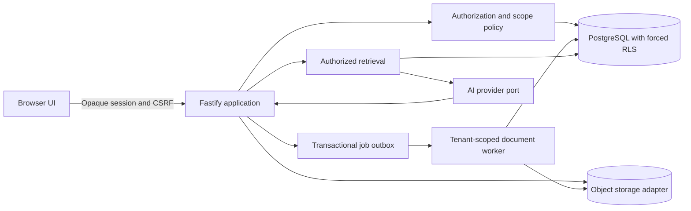

# Private Company AI

Private Company AI is a multi-tenant employee-operations and company-knowledge platform for small and midsize businesses. It brings approved policies, employee operational records, compliance deadlines, controlled imports, notifications, and role-aware AI answers into one private workspace.

The product is designed to help an owner, operations lead, HR team, manager, or employee find the correct operational information quickly without exposing records outside their authorized role or company. The long-term business is a subscription SaaS product with guided onboarding and optional paid implementation for multi-location service businesses.

> Current release status: functional synthetic-data MVP and sales-demo foundation. The complete demo, automated test suite, database isolation, invitation flow, and GitHub CI are working. Real employee data and production deployment require the remaining identity, infrastructure, file-security, legal, privacy, and penetration-testing gates documented below.

## Repository and handoff status

- GitHub: `git@github.com:minmin7min/Local-AI.git`
- Active branch: `codex/secure-mvp`
- Latest documented handoff commit before this README update: `e8a0966`
- Latest verified release run: [GitHub Actions CI #33](https://github.com/minmin7min/Local-AI/actions/runs/30230136412)
- Local project path on the original Mac: `/Users/okitananami/Documents/Local AI for businesses`
- Runtime: Node.js 22+, TypeScript, Fastify, PostgreSQL 16+, browser JavaScript, Docker Compose
- Package manager: npm with a committed lockfile
- License: private repository; no public license has been granted

Everything required to understand and continue the application is committed to GitHub: source code, migrations, tests, synthetic fixtures, Docker configuration, CI configuration, security decisions, operational instructions, demo workflows, and launch planning. Local databases, object-storage contents, dependency folders, credentials, and `.env` files are intentionally recreated on each machine rather than committed.

## Product idea

### The problem

Small and midsize businesses often keep employee operations in a mixture of spreadsheets, shared drives, email, chat, paper checklists, and disconnected HR tools. This creates recurring problems:

- Employees cannot quickly find the latest approved policy or procedure.
- Managers do not have a reliable view of training, certification, equipment, or upcoming deadlines for their teams.
- HR repeatedly answers questions that should be resolved from approved company material.
- Owners lack an operational overview without receiving unnecessary access to sensitive employee information.
- Spreadsheet imports are error-prone and can silently create inconsistent employee records.
- Generic AI tools can expose confidential information, ignore role boundaries, invent answers, or cite outdated documents.
- Multi-location businesses need one system while still maintaining company, department, role, and reporting-line boundaries.

### The solution

Private Company AI provides a private company workspace where authorized users can:

- Import and maintain operational employee records.
- Track training, certifications, equipment assignments, reporting relationships, and deadlines.
- Upload company policies and move them through extraction, review, and approval.
- Ask natural-language questions and receive answers grounded only in approved, current, authorized sources.
- See citations and use a fixed escalation response when approved evidence is unavailable.
- Receive scoped deadline summaries and in-app notifications.
- Manage workspace users, roles, invitations, settings, and audit history.
- Keep every database operation tenant-scoped through application authorization and forced PostgreSQL row-level security.

### Initial customer wedge

The recommended first customer is an owner, operations leader, or HR lead at a 20–100 person, multi-location service business. The two initial verticals are:

1. Café and restaurant groups.
2. Property-service and field-service companies.

The initial high-value workflows are approved-policy questions, employee training/certification tracking, operational deadlines, and controlled employee imports. These workflows are represented by the fictional Northstar Café Group and Cedar Property Services demo tenants.

### Business model hypothesis

- Paid onboarding or implementation fee for setup, policy preparation, and employee-data mapping.
- Monthly per-company subscription, with pricing validated through buyer interviews before publication.
- Optional higher tiers for integrations, SSO, additional storage, advanced reporting, and premium support.
- Initial design-partner program with three to five companies and explicit success metrics.

The first sales motion is founder-led discovery, synthetic demonstrations, and design-partner recruitment. Measure time saved finding policy answers, reduction in overdue records, setup time, weekly active operators, required integrations, security objections, and willingness to pay.

## Users and authorization

Roles are additive and tenant-scoped. The server derives permissions from the authenticated membership; hidden UI controls are never treated as authorization.

| Capability | Employee | Manager | HR | Owner | Tenant administrator |
|---|---:|---:|---:|---:|---:|
| Own operational record and deadlines | Yes | Yes | If linked | If linked | No by default |
| Direct-report operational records | No | Yes | Yes | Approved summary | No by default |
| Tenant employee operational fields | No | No | Yes | Approved fields | No by default |
| Approved/current policies | By audience | By audience | By audience | By audience | Yes |
| Employee import and correction | No | No | Yes | No | Yes |
| Document upload, review, and approval | No | No | No | No | Yes |
| Deadline summaries | Own | Team | Tenant | Tenant | System health only |
| Membership and role administration | No | No | No | Yes | Yes |
| Tenant audit viewer | No | No | No | No by default | Yes |

Manager scope comes from effective reporting relationships. Owner is not a sensitive-field bypass. Field projection occurs before serialization and before evidence is supplied to an AI provider. Inaccessible resources return a generic denial that does not reveal whether another tenant owns the identifier.

## Implemented product workflows

### Authentication and onboarding

- Opaque server-side session cookies.
- HttpOnly, SameSite cookies with secure cookies in production mode.
- Argon2id password hashing.
- CSRF tokens for state-changing authenticated requests.
- Login rate limiting and generic credential failures.
- Session revocation on logout and membership deactivation.
- Tenant-scoped invitations with cryptographically random setup tokens.
- Only SHA-256 hashes of invitation tokens are stored.
- Invitations expire after 48 hours and are consumed atomically.
- Invited users choose their own passwords; administrators do not need to know them.
- Preview invitation links are displayed in the UI because transactional email is not yet connected.

### Employee operations

- Tenant-scoped employee directory.
- Employee, manager, HR, owner, and tenant-administrator views.
- Department and position information.
- Training status and due dates.
- Certification status and expiration dates.
- Equipment assignments and returns.
- Effective reporting relationships.
- Operational deadlines generated from source records.
- Employee archiving and versioned operational updates.

The intentionally excluded sensitive domains include salary, benefits, leave balances, emergency contacts, performance reviews, disciplinary matters, medical details, banking information, passports, government identifiers, and immigration information.

### Imports

- CSV and XLSX input.
- Strict canonical headers and bounded file processing.
- Formula rejection rather than spreadsheet execution.
- Row-level normalization and validation errors.
- Persistent preview before any employee record changes.
- Explicit commit step.
- Locked and idempotent import processing.
- Tenant-scoped batch, row, and audit records.
- Synthetic sample files under `samples/`.

### Policy library and document processing

- PDF, DOCX, CSV, and XLSX uploads.
- Actual file-type detection and upload-size limits.
- Safe generated storage keys rather than user-controlled paths.
- Local object-storage adapter for development.
- Tenant-bearing background jobs.
- Tenant-specific workers with `FOR UPDATE SKIP LOCKED` job claiming.
- Bounded document extraction.
- Version lifecycle: `processing -> review -> approved | rejected | failed | archived`.
- One current version per document.
- Audience-role authorization.
- Only approved and current material is available for ordinary answers.
- Authorized private downloads.

### Grounded company knowledge

- Deterministic PostgreSQL full-text retrieval for the MVP.
- Natural-language keyword matching against authorized policy sections.
- Approved/current/audience gating before retrieval.
- Structured citations stored independently from the generated answer.
- Citation source validation before response.
- Fixed escalation/no-answer response when approved evidence is unavailable.
- Document text is treated as untrusted evidence, not executable instructions.
- Provider-neutral `AIProvider` interface for a future reviewed model provider.
- Deterministic provider for tests and demonstrations; production model integration remains an explicit roadmap item.

### Dashboard, deadlines, and notifications

- Role-scoped dashboard counts.
- Own, team, or tenant deadline views depending on authorization.
- Deadline windows and overdue handling.
- Idempotent in-app reminder generation.
- Membership-scoped notifications.

### Administration and auditing

- List active and deactivated workspace users.
- Create synthetic preview users or use the preferred invitation workflow.
- Additive role assignment and replacement.
- Last-administrator protection.
- Self-deactivation protection.
- Session revocation when a member is deactivated.
- Company name, timezone, retention, reminder-window, and notification settings.
- Tenant-administrator audit feed.
- Metadata-focused audit events for authentication-independent business actions, role changes, policy questions, imports, document lifecycle, invitation creation/acceptance, and settings updates.

## Architecture

The application is a TypeScript modular monolith with one Fastify HTTP process, one PostgreSQL database, tenant-specific document workers, and ports for storage and AI providers. This keeps authorization and transactions inside one trust boundary while allowing workers, storage, retrieval, and model providers to become independent services later.



For each protected request, the server authenticates the opaque session, resolves the active tenant membership and roles, opens a database transaction, sets transaction-local tenant/user/membership context, applies action and field authorization, retrieves only permitted rows, records a redacted audit event when applicable, and commits. Tenant identifiers supplied by a browser are resource identifiers, never proof of authority.

### Technology choices

- Node.js 22+ and strict TypeScript.
- Fastify 5 with secure cookies, Helmet/CSP, multipart limits, rate limiting, and structured Pino logs.
- PostgreSQL 16+ for constraints, transactions, full-text search, advisory locks, and forced row-level security.
- Parameterized SQL and Drizzle-compatible schema boundaries.
- Argon2id for passwords and SHA-256 for high-entropy opaque token lookup.
- Filesystem storage locally; private encrypted object storage is required for production.
- Vitest for domain, API, security, and database integration tests.
- Playwright/Chromium for full-browser acceptance tests.
- Docker Compose for a reproducible local stack.

### Primary entities

- Tenants and tenant settings.
- Users, memberships, membership roles, sessions, and invitations.
- Departments, employees, and reporting relationships.
- Training, certifications, equipment assignments, and deadlines.
- Import batches and import rows.
- Documents, document versions, and document sections.
- Background jobs.
- Chat sessions, messages, and citations.
- Notifications and audit events.

Tenant-owned entities carry `tenant_id`. Composite tenant foreign keys prevent cross-tenant relationships even if an application query is incorrect. Forced RLS is tested using a non-owner PostgreSQL runtime role without `BYPASSRLS`.

## Repository map

```text
.
├── .github/
│   ├── workflows/ci.yml        Release checks
│   └── dependabot.yml          Dependency updates
├── docker/postgres/            Local PostgreSQL role initialization
├── docs/                       Detailed product, security, API, and operations records
├── migrations/                 Ordered PostgreSQL migrations
├── public/                     Browser UI, styles, and client logic
├── samples/                    Fictional CSV/XLSX/PDF/DOCX demo files
├── scripts/                    Migration, seed, worker, reminder, and test-DB scripts
├── src/
│   ├── adapters/               PostgreSQL and local-storage implementations
│   ├── domain/                 Business rules, authorization, parsing, and services
│   ├── routes/                 Fastify HTTP route modules
│   ├── app.ts                  Application composition and HTTP security
│   ├── config.ts               Validated environment configuration
│   └── server.ts               Production process wiring
├── tests/
│   ├── e2e/                    Chromium acceptance journeys
│   └── *.test.ts               Unit, API, security, and PostgreSQL tests
├── compose.yaml                Complete local stack
├── Dockerfile                  Production-style Node container
├── package.json                Scripts and dependencies
├── playwright.config.ts        Browser-test server and browser configuration
├── tsconfig.json               Strict TypeScript configuration
└── vitest.config.ts            Test discovery configuration
```

## Start on a new laptop

### Prerequisites

- Git.
- Node.js 22 or newer.
- npm.
- Docker Desktop with Docker Compose for the easiest complete environment.
- A GitHub SSH key authorized for the private repository, or an HTTPS credential.
- Claude Code, Codex, or another development environment if desired.

### Clone with SSH

```bash
ssh -T git@github.com
git clone git@github.com:minmin7min/Local-AI.git
cd Local-AI
git switch codex/secure-mvp
npm ci
```

### Clone with HTTPS

```bash
git clone https://github.com/minmin7min/Local-AI.git
cd Local-AI
git switch codex/secure-mvp
npm ci
```

### Continue with Claude Code

```bash
cd Local-AI
claude
```

Recommended first prompt:

```text
Read README.md and every document in docs/. Inspect the current Git branch and
recent commits. This repository is a working multi-tenant employee-operations
MVP with PostgreSQL RLS and automated release checks. Run the existing checks
before changing code. Preserve tenant isolation, authorization, auditability,
grounded citations, and secure handling of credentials and files. Continue from
the prioritized roadmap in this README and docs/READINESS.md. Commit coherent,
tested milestones to codex/secure-mvp or to a new reviewed feature branch.
```

## Run the complete Docker demo

Build and start PostgreSQL, migrations, the application, and both tenant workers:

```bash
docker compose up --build
```

In another terminal, seed the fictional tenants:

```bash
docker compose run --rm \
  -e DATABASE_URL=postgresql://pcai_runtime:local-runtime-development-only@db:5432/private_company_ai \
  app node dist/scripts/seed.js
```

Open `http://127.0.0.1:3000` and select **Enter the full demo**.

All seeded accounts use this development-only password:

```text
Synthetic-Demo-Only-Change-Me!
```

| Workspace | Account | Role |
|---|---|---|
| `northstar` | `avery.morgan@northstar.example.invalid` | Employee |
| `northstar` | `jordan.lee@northstar.example.invalid` | Manager |
| `northstar` | `riley.chen@northstar.example.invalid` | HR |
| `northstar` | `casey.bennett@northstar.example.invalid` | Owner + tenant administrator |
| `cedar` | `avery.morgan@cedar.example.invalid` | Employee |
| `cedar` | `jordan.lee@cedar.example.invalid` | Manager |
| `cedar` | `riley.chen@cedar.example.invalid` | HR + tenant administrator |

The demo button signs in as the fictional Northstar owner and exposes all product sections. Detailed validation steps are in `docs/DEMO_RUNBOOK.md`.

## Run without Docker

1. Install and start PostgreSQL 16+.
2. Create a database and a non-owner runtime role without `BYPASSRLS`.
3. Copy `.env.example` to `.env` and replace every placeholder locally.
4. Keep `MIGRATION_DATABASE_URL` available only to the migration command; the application should receive only `DATABASE_URL` for the runtime role.
5. Install, migrate, seed, verify, and start:

```bash
cp .env.example .env
npm ci
npm run db:migrate
npm run db:seed
npm run lint
npm run typecheck
npm test
npm run build
npm run dev
```

Open `http://127.0.0.1:3000`.

## Environment configuration

| Variable | Purpose | Local default/example |
|---|---|---|
| `NODE_ENV` | `development`, `test`, or `production` security behavior | `development` |
| `PORT` | HTTP port | `3000` |
| `HOST` | Bind address | `127.0.0.1` |
| `DATABASE_URL` | Least-privilege runtime PostgreSQL connection | Required |
| `MIGRATION_DATABASE_URL` | Optional privileged migration-only connection | Optional |
| `SESSION_SECRET` | Cookie-signing secret, at least 32 characters | Required |
| `STORAGE_ROOT` | Local object-storage directory | `./storage` |
| `AI_PROVIDER` | Provider selection; deterministic is the implemented runtime baseline | `deterministic` |
| `AI_MODEL` | Model/configuration label | `deterministic-v1` |
| `MAX_UPLOAD_BYTES` | Maximum upload size, capped at 25 MB | `10485760` |
| `SESSION_TTL_SECONDS` | Session lifetime, 15 minutes to 24 hours | `28800` |

Never commit `.env`, private keys, access tokens, production database URLs, real customer exports, or object-storage contents. `.env.example` contains placeholders only.

## Available commands

| Command | Purpose |
|---|---|
| `npm run dev` | Start the TypeScript server in watch mode |
| `npm run build` | Compile TypeScript into `dist/` |
| `npm start` | Run the compiled server |
| `npm run lint` | Run ESLint |
| `npm run typecheck` | Run strict TypeScript checking without output |
| `npm test` | Run unit, API, domain, and security tests |
| `npm run test:integration` | Run the real PostgreSQL/RLS suite when `TEST_DATABASE_URL` is configured |
| `npm run test:e2e` | Start a test server and run Chromium acceptance tests |
| `npm run test:e2e:ui` | Open the interactive Playwright test runner |
| `npm run test:watch` | Run Vitest in watch mode |
| `npm run db:test:setup` | Create/configure the non-owner test runtime role |
| `npm run db:migrate` | Apply unapplied ordered migrations under an advisory lock |
| `npm run db:seed` | Seed the two fictional tenants |
| `npm run worker -- <tenant-uuid>` | Process one document job for a tenant |
| `npm run worker -- <tenant-uuid> --loop` | Continuously process tenant document jobs |
| `npm run reminders -- <tenant-uuid>` | Generate idempotent in-app reminders |

## Demonstration walkthrough

1. Enter the full Northstar demo and inspect the role-scoped dashboard.
2. Open People and inspect the fictional employee operational record.
3. Sign in as Northstar HR and preview/commit `samples/synthetic-employees.xlsx`.
4. Sign in as the Northstar tenant administrator and upload `samples/synthetic-sick-leave-policy.docx`.
5. Allow the Northstar worker to extract the document, refresh Policies, review it, and approve it.
6. Sign in as Avery and ask: “I am sick and cannot work today. What should I do?”
7. Confirm the answer tells the employee to contact their manager before the shift and reports one approved source.
8. Sign in as Jordan and confirm direct-report visibility without unrelated employee visibility.
9. Sign in as the tenant administrator, review settings/users/audit events, and create a fictional invitation.
10. Open the invitation link in a separate browser context, create a password, sign in, and confirm employee-only navigation.
11. Sign in to Cedar and confirm that Northstar employees, documents, citations, imports, and audits cannot be accessed.

## Automated quality and release checks

The local and GitHub suites cover:

- Strict TypeScript and ESLint.
- 45 unit/API/domain/security tests.
- Seven PostgreSQL integration tests using the non-owner `pcai_runtime` role.
- Forced-RLS isolation and cross-tenant read/write denial.
- Session creation, resolution, CSRF protection, and revocation.
- Role lifecycle and last-administrator protection.
- One-time invitation acceptance and replay rejection.
- Operational-record scope and source-linked deadline generation.
- Four Chromium journeys covering the full demo, grounded answers, administration, invitations, employee role visibility, and cross-tenant denial.
- Production dependency audit with zero known vulnerabilities at the latest verified milestone.

GitHub Actions contains three jobs:

1. `quality`: install, lint, type-check, unit/security tests, and build.
2. `postgres-integration`: clean PostgreSQL, migrations, synthetic seed, RLS integration tests, build, Chromium installation, and browser tests.
3. `dependency-review`: high-severity production dependency audit with visible handling for advisory-service outages.

Browser failure reports are uploaded as short-lived CI artifacts. Dependabot manages grouped production, development, and GitHub Actions updates.

Run the standard local gate with:

```bash
npm run lint
npm run typecheck
npm test
npm run build
```

## Security and privacy design

The browser, uploads, filenames, extracted text, spreadsheet values, model output, provider responses, and identifiers are treated as untrusted input.

Implemented controls include:

- Forced PostgreSQL RLS and composite tenant foreign keys.
- Transaction-local tenant, user, and membership context.
- Server-side action, resource, field, and reporting-scope authorization.
- Parameterized SQL.
- Opaque revocable sessions, CSRF, CSP, SameSite/HttpOnly cookies, and rate limits.
- Argon2id password hashing and hashed high-entropy invitation/session credentials.
- Output encoding in the browser.
- Generic cross-tenant denial responses.
- MIME, file-size, archive, formula, and filename defenses.
- Tenant-prefixed storage and idempotency keys.
- Approved/current policy gating and evidence-ID validation.
- Metadata-focused, redacted logs and audit records.
- Synthetic fixtures under reserved `.example.invalid` domains.

Production infrastructure must use separate migration, application, and worker database identities; runtime identities must not own tables or receive `BYPASSRLS`. It also needs private networking, TLS, encrypted storage/backups, managed secrets, outbound allowlists, malware scanning, parser resource isolation, monitoring, alerting, restore exercises, and controlled tenant support access.

No compliance certification is claimed by this repository. Legal, privacy, employment-data, cloud-security, and AI-provider reviews are business launch requirements, not substitutes for engineering tests.

## Current stage

### Complete and working

- Multi-tenant data model and forced-RLS foundation.
- Authentication, CSRF, opaque sessions, role authorization, and revocation.
- Secure one-time synthetic invitation and password-setup workflow.
- Employee records, imports, training, certifications, equipment, reporting, and deadlines.
- Document upload, extraction, review, approval, retrieval, and citation workflows.
- Dashboard, notifications, settings, users/roles, and audit feed.
- Full-access demo entry and two fictional tenants.
- Docker-based local environment.
- Unit, security, PostgreSQL/RLS, browser, build, lint, type-check, dependency, and CI checks.
- Product, architecture, authorization, API, security, operations, audit, demo, readiness, and business-launch documentation.

### Remaining before a real-data production pilot

1. Connect secure transactional email and sending-domain controls.
2. Add email verification, MFA/passkeys or TOTP, account recovery, breached-password checks, and session/device management.
3. Extend browser automation to the complete destructive import and document upload/worker/approval journeys.
4. Deploy private staging with infrastructure as code, managed PostgreSQL, private object storage, secrets, TLS, monitoring, alerts, and separated identities.
5. Add malware scanning/CDR and hardened parser sandboxes with CPU, memory, time, archive, and egress limits.
6. Implement tenant export, deletion, backup expiration, restore rehearsal, incident response, and tenant-approved support access.
7. Select an AI provider only after residency, retention, training use, abuse monitoring, subprocessors, deletion, and DPA review.
8. Implement the production provider adapter, budgets, timeouts, retries, observability, answer-quality evaluations, and adversarial prompt-injection tests.
9. Publish OpenAPI schemas and complete accessibility, load, abuse, static, container, IaC, SBOM, and penetration testing.
10. Obtain privacy impact, employment-data, contract/DPA, cloud architecture, incident-response, and legal reviews for the initial jurisdiction.

The synthetic-only application gate should be removed only through a reviewed production release after those controls have documented evidence. This is a release-state fact, not a limitation on what the product may ultimately become.

## Recommended execution order

### Engineering

1. Finish identity and email delivery.
2. Complete every browser acceptance workflow.
3. Build private staging and observability.
4. Harden the file-processing pipeline.
5. Build export/deletion and disaster-recovery workflows.
6. Integrate and evaluate the selected AI provider.
7. Complete API, accessibility, performance, abuse, container, IaC, SBOM, and security testing.

### Business

1. Select one initial country and province/state.
2. Interview ten qualified buyers in the initial verticals.
3. Recruit three to five design partners for synthetic demonstrations.
4. Validate pricing, purchase authority, required integrations, onboarding effort, and measurable value.
5. Select the cloud region, transactional email provider, authentication approach, file-security services, and reviewed AI provider.
6. Prepare the company entity, banking, accounting, insurance, contracts, privacy materials, support process, and incident contacts with qualified professionals.
7. Convert a design partner to a real-data pilot only after every production gate has evidence and approval.

## Decisions the founder must make

| Decision | Recommended direction | Why it matters |
|---|---|---|
| First jurisdiction | One country and one province/state | Determines privacy, employment, retention, deletion, and contract review |
| Initial niche | Café/restaurant groups or property services | Keeps sales, onboarding, policy templates, and integrations focused |
| Cloud and region | One managed provider and nearby region | Unblocks staging, private networking, backups, monitoring, and IaC |
| Transactional email | Dedicated sending subdomain with SPF, DKIM, DMARC, suppression, and delivery events | Unblocks real invitations, verification, MFA, and recovery |
| Authentication | Passkeys/TOTP first; SSO when required by a customer | Balances launch speed with account security |
| File security | Private object storage, malware scanning, and parser isolation | Required before accepting real company files |
| AI provider | Select after contractual and technical data-handling review | Controls confidentiality, residency, retention, cost, and answer quality |
| Professional reviewers | Privacy/employment counsel and independent application-security tester | Required for real-data pilot evidence and contracts |

## Documentation index

- [`docs/ARCHITECTURE.md`](docs/ARCHITECTURE.md): component boundaries, data flow, entity model, and deployment architecture.
- [`docs/AUTHORIZATION.md`](docs/AUTHORIZATION.md): role/capability matrix and scope rules.
- [`docs/API.md`](docs/API.md): current HTTP endpoint inventory.
- [`docs/AUDIT_EVENTS.md`](docs/AUDIT_EVENTS.md): audit actions and metadata conventions.
- [`docs/SECURITY.md`](docs/SECURITY.md): threat model, privacy boundaries, and unresolved production risks.
- [`docs/OPERATIONS.md`](docs/OPERATIONS.md): local operations, backups, recovery, and security checklist.
- [`docs/DEMO_RUNBOOK.md`](docs/DEMO_RUNBOOK.md): synthetic accounts and representative walkthrough.
- [`docs/READINESS.md`](docs/READINESS.md): evidence-based product and launch gates.
- [`docs/LAUNCH_DECISIONS.md`](docs/LAUNCH_DECISIONS.md): founder decisions, design-partner motion, and execution queue.

## Continuation principles

Future development can expand the product into integrations, payroll/HRIS connectors, SSO, mobile experiences, analytics, vector retrieval, workflow automation, multilingual policies, customer-configurable fields, and additional verticals. New capabilities should extend the existing tenant, authorization, audit, provider, storage, and worker boundaries rather than bypassing them.

Before merging a milestone:

1. Update or add migrations and tests with the feature.
2. Verify tenant and role scope server-side.
3. Ensure untrusted content is bounded and output-encoded.
4. Keep secrets and customer data outside Git.
5. Run lint, type-check, tests, build, PostgreSQL/RLS integration, browser tests when applicable, and the dependency audit.
6. Update this README and the detailed evidence documents when readiness changes.

The objective is not merely to make a demo appear complete. The objective is to build a useful, sellable company-operations product whose access boundaries, evidence, and operational claims remain true as it grows.
