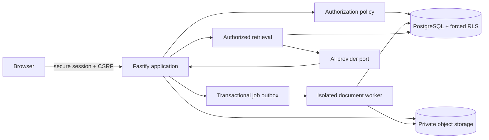

# Architecture

## Status and scope

This repository began as an empty Git repository. The MVP is a TypeScript modular monolith with one HTTP process, one PostgreSQL database, and a separately runnable document/job worker. A modular monolith keeps transactions and authorization in one trust boundary; workers and AI providers are ports that can be split into services when load or isolation needs justify it.

## Stack decision

- Node.js 22+ and TypeScript with strict checking: shared types, mature server ecosystem, and maintainable provider/worker boundaries.
- Fastify: schema-friendly APIs, bounded request bodies, low overhead, secure plugin ecosystem, and structured Pino logging.
- PostgreSQL 16+: relational constraints, transactions, full-text search, advisory locks, and row-level security (RLS). PostgreSQL text search is the safe MVP retrieval baseline; pgvector may be added behind the retrieval port.
- Drizzle ORM/query builder: typed SQL and explicit migrations without hiding tenant predicates. Direct parameterized SQL remains appropriate for RLS-sensitive queries.
- Server-side opaque sessions: revocable, short-lived sessions avoid long-lived bearer tokens in browsers. Argon2id is used for local passwords. MFA and account recovery are pre-production requirements.
- PostgreSQL job outbox/worker: tenant-bearing payloads and unique idempotency keys. A dedicated queue such as Graphile Worker can replace polling without changing domain services.
- Filesystem object-store adapter for local development; production requires private encrypted object storage, malware scanning, quarantine, and scoped service credentials.
- Provider-neutral `AIProvider` port with deterministic tests. No customer data is sent unless an authorized request requires it and provider terms/configuration have been reviewed.

Tradeoffs: PostgreSQL RLS increases migration and operational complexity and does not replace object/field authorization, but contains query mistakes. The modular monolith has less deployment complexity than microservices but requires disciplined module boundaries. Full-text search is less semantically capable than embeddings but is deterministic, inspectable, and avoids external disclosure in the MVP baseline.

## Component and data flow

For every request: authenticate opaque session; resolve active membership and roles server-side; start a database transaction; set transaction-local tenant/user/membership context; authorize action and field/scope; retrieve only permitted rows/chunks; perform work; append a redacted audit event; commit. Tenant IDs in URLs or bodies are never authority.

For a policy question: classify with deterministic rules first (dates/counts/statuses use relational queries); build an authorized evidence set; pass only evidence to the model with document text delimited as untrusted data; validate structured evidence IDs; store citations separately; return the fixed no-answer response when evidence is empty.

## Entity model

Tenant membership and roles are separate from employee profiles. Employee profiles link optionally to a membership. Departments, reporting relationships, training, certifications, equipment, deadlines, imports, documents and versions, sections, chat, citations, notifications, and audits all carry `tenant_id`. Composite foreign keys include `tenant_id`, preventing cross-tenant relationships even if application logic fails.

Document lifecycle is `processing -> review -> approved|rejected`, with failed processing retryable and terminal versions archivable. Only one current version per document is allowed. Normal retrieval requires approved + current + audience/department authorization.

## Deployment

Use separate least-privilege PostgreSQL roles for migrations, application, and worker; the runtime roles must not own tables or have `BYPASSRLS`. Terminate TLS at a managed ingress, use a private database/network, encrypted backups and object storage, managed secrets, outbound allowlists, WAF/rate limiting, centralized redacted logs, metrics/traces, and alerts. Run workers in a sandbox with CPU, memory, page, time, and egress limits. Restore tests and tenant-deletion rehearsals are mandatory before production.
